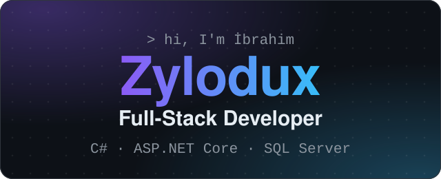
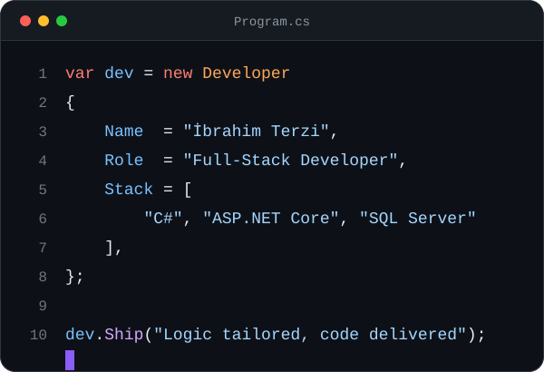
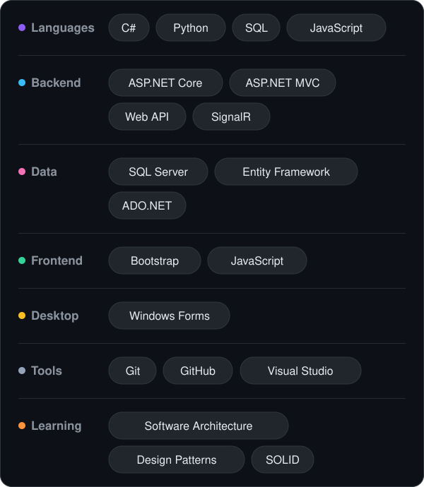
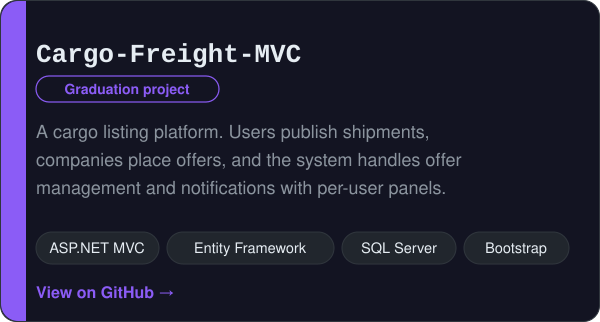
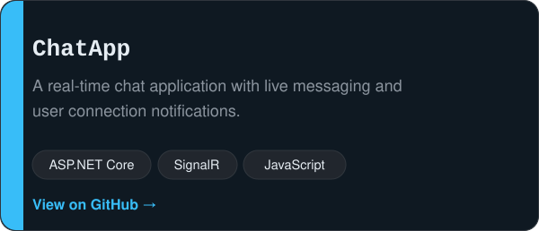
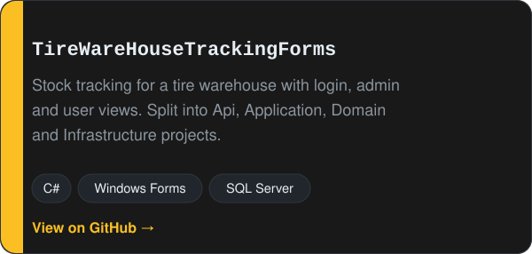
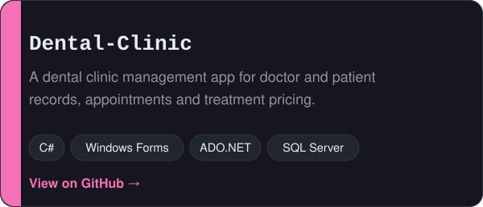
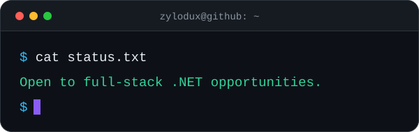

  

  I build web and desktop applications with <b>C#</b> and <b>.NET</b>, from the SQL Server schema to the UI, turning real business workflows into clean, layered software.

  
  
  

<h2 align="center">About</h2>

  

<h2 align="center">Tech Stack</h2>

  

<h2 align="center">Featured Projects</h2>

  

  

  

  

  <a href="https://github.com/Zylodux?tab=repositories">Browse all repositories →</a>

<h2 align="center">Let's Connect</h2>

  

